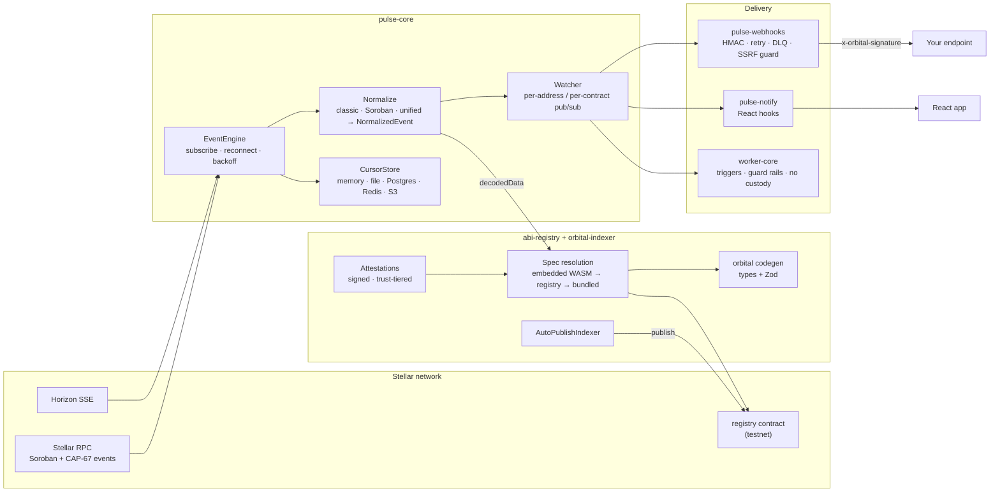

# Orbital

[](https://www.npmjs.com/package/@orbital-stellar/pulse-core)
[](LICENSE)
[](https://github.com/orbital-stellar/orbital_stellar/actions/workflows/ci.yml)
[](https://github.com/orbital-stellar/orbital_stellar/actions/workflows/ci.yml)
[](https://github.com/orbital-stellar/orbital_stellar/actions/workflows/codeql.yml)
[](tsconfig.base.json)
[](.github/workflows/ci.yml)
[](https://www.conventionalcommits.org)

> **Status**: `v0.2.0` on npm (all seven packages) &nbsp;·&nbsp; **Contracts**: testnet only &nbsp;·&nbsp; **License**: MIT
>
> The libraries read both networks. Orbital's own contracts are deployed to testnet and not yet to mainnet. `main` is ahead of npm - see [What works today](#what-works-today) for which is which.

**Stellar's biggest developer-experience gap is that Soroban events arrive as raw, untyped payloads with no shared vocabulary - every team invents its own decoding, and no two teams agree on what a `swap` or a `liquidation` even is.**

Orbital ships the typed event layer once, openly:

- an **open ABI / event-schema registry** - on-chain on testnet, with signed attestations and a growing set of verified schemas for live mainnet protocols - that makes decoding canonical;
- a **typed event engine** that normalizes Horizon, Soroban and CAP-67 unified events into application-shaped `NormalizedEvent`s;
- **`orbital codegen`**, which puts those types into your codebase;
- composable **webhook delivery**, **React hooks**, **anchor clients** and a **no-custody worker runtime**.

Seven MIT-licensed packages, designed to be composed.

---

## Table of contents

- [Why this exists](#why-this-exists)
- [What works today](#what-works-today)
- [Packages](#packages)
- [Quickstart](#quickstart)
- [Starters](#starters)
- [Architecture](#architecture)
- [Repository layout](#repository-layout)
- [Documentation](#documentation)
- [Production hosting](#production-hosting)
- [Roadmap](#roadmap)
- [Contributing](#contributing)
- [Contributors](#contributors)
- [License](#license)

---

## Why this exists

Stellar's official APIs give you the raw firehose - and not much else:

- **Soroban contract events** decode to raw topic/value XDR with no shared schema - every team writes its own one-off decoder, and there's no canonical place to look up what a given contract's events mean.
- **Horizon SSE** drops on idle, requires backoff, and surfaces raw operations rather than application-friendly events.
- **Stellar RPC** keeps only ~7 days of Soroban history and has no native subscription model.
- **Webhooks** aren't part of the platform - every project rebuilds HMAC signing, retry, SSRF guards, and edge-runtime verification from scratch.
- **React integration** doesn't exist - every dashboard rebuilds SSE plumbing and lifecycle management.

Every serious Stellar app - wallet, dashboard, anchor integration, analytics tool - re-solves the same problem. Orbital ships those primitives once, and the registry that makes decoding canonical, so you can `pnpm add` them instead of rebuilding them.

For how this sits against SEP-48, the official JS SDK, Mercury and the other Stellar indexers - including where they win - see [`docs/competitive-landscape.md`](docs/competitive-landscape.md). The longer-form thesis and plan live in [`ROADMAP.md`](ROADMAP.md) and [`docs/proposal.md`](docs/proposal.md).

---

## What works today

"It is in the repo" and "you can install it and it works" are not the same claim, so they are separated here. **npm** is the `0.2.0` release (2026-09-23). **`main` only** means merged but not yet released - install from source to use it, and see `[Unreleased]` in the [CHANGELOG](CHANGELOG.md) and each package's own changelog.

### Event ingestion - `pulse-core`

| Capability | Where | Notes |
|---|---|---|
| Horizon SSE subscription + full classic taxonomy | npm `0.2.0` | Payments, account create/merge/options/bump-sequence, trustlines + auth, offers, claimable balances, liquidity pools, manage-data |
| Soroban contract events | npm `0.2.0` | `engine.subscribeContract({ contractId, topics })`; `contract.invoked` / `contract.emitted` |
| CAP-67 unified asset events (Protocol 23) | npm `0.2.0` | `ingestion: "unified" \| "horizon" \| "auto"` plus `soroban.unifiedEvents`; transfer / mint / burn / clawback / fee / set_authorized decoders. Default stays `"horizon"` |
| Typed `decodedData` with zero config | npm `0.2.0` | `abiRegistry` defaults to the bundled + on-chain registry; `abiRegistry: false` opts out |
| Reconnection, rate-limit backoff, dedupe | npm `0.2.0` | AWS full-jitter, `Retry-After` parsing, lifecycle notifications |
| Cursor persistence | npm `0.2.0` | Memory, file, Postgres, Redis, S3, plus `cacheCursorStore` / `coalesceCursorStore` wrappers; `orbital cursor` backup CLI |
| Multi-network engine | npm `0.2.0` | `network` accepts an array of sources, merged under one engine |
| Historical replay source | npm `0.2.0` | `RpcHistoricalSource` (bounded by RPC's ~7-day retention) |

### Decoding standard - `abi-registry`, `orbital-indexer`

| Capability | Where | Notes |
|---|---|---|
| Registry clients + WASM auto-discovery | npm `0.2.0` | `createDefaultAbiRegistryClient()`, `OnChainAbiRegistryClient`, `discoverContractSpec()`, `ChainedAbiRegistryClient` (SEP-48 precedence) |
| `orbital codegen` | npm `0.2.0` | `orbital.config.ts` manifest, `--watch`, `--check` drift gate for CI; TypeScript types + Zod schemas. Also `orbital typegen <contractId>` |
| `abi-registry verify` CLI | npm `0.2.0` | Verifies a schema against deployed WASM; exit codes per verdict for CI |
| Semantic taxonomy format | npm `0.2.0` | `schema/taxonomy.schema.json`, `validateTaxonomyEntry()`, `findTaxonomyConflicts()` |
| Auto-publish indexer | npm `0.2.0` | `AutoPublishIndexer` discovers specs for unregistered contracts and publishes them on-chain |
| **Signed attestations, envelope v1** | `main` only - **breaking** | SEP-53 signing with domain separation, RFC 8785 canonical JSON, expiry + supersession, trust tiers (`deployer` > `third-party` > `unbound`). Conformance vectors + Go and Rust reference verifiers. 0.2.0 envelopes must be re-signed |
| **Verified mainnet schemas** | `main` only | 29 community-contributed specs in [`specs/community/`](packages/abi-registry/specs/community), each with a `match` verdict re-checked in CI - Blend, Soroswap, Phoenix, Aquarius, Reflector, DeFindex, FxDAO, Comet, Allbridge, KALE, Slender, Orbit and more |
| **Mainnet-aware registry selection** | `main` only | `createDefaultAbiRegistryClient({ network: "mainnet" })`; skips the on-chain link until a mainnet registry exists, never falls back to testnet |
| Open data (taxonomy + entity labels) | repo | [`data/`](data) - `taxonomy.json`, `labels.json`, per-protocol labels, integrity hashes |

### Delivery, UI, anchors, workers

| Capability | Where | Notes |
|---|---|---|
| HMAC webhook delivery + verification | npm `0.2.0` | `verifyWebhook` (Node) / `verifyWebhookEdge` (Web Crypto), SSRF + DNS-rebinding guard |
| Durable retry + dead-letter queues | npm `0.2.0` | Retry: memory, Redis, Postgres, SQS. DLQ: memory, Postgres, with the `orbital-dlq` CLI. Prometheus + OpenTelemetry metrics |
| React hooks | npm `0.2.0` | 4.6 kB gzip; Suspense, error boundary, devtools panel, Vite plugin |
| Anchor clients | npm `0.2.0` | SEP-1, SEP-10 (challenge verified before signing), SEP-12, SEP-24, SEP-31. Never holds a secret key |
| Worker runtime (W0-W3) | npm `0.2.0` | Triggers, schedules, guard rails, paymaster, verification, operator reputation, registry, `orbital-worker` CLI. Workers only call functions anyone could call - [`contracts/payroll`](contracts/payroll)'s `disburse()` is the reference. **No custody anywhere**; W4 (vault, latency tier) was dropped |

### On-chain status

| Contract | Testnet | Mainnet |
|---|---|---|
| `registry` | deployed, 4 specs published | not deployed |
| `demo-emitter` | deployed | not deployed (testnet fixture by design) |
| `payroll` | deployed | not deployed |
| `vault` | placeholder crate, not a contract | - |

The testnet `registry` holds four published specs - USD Coin (USDC), Euro Coin (EURC), Aquarius (AQUA) and the native asset wrapper (XLM SAC). [`contracts/deployed.testnet.json`](contracts/deployed.testnet.json) is the source of record for every contract ID, WASM hash and published spec hash. Nothing is deployed to mainnet; see [`docs/mainnet-deployment.md`](docs/mainnet-deployment.md).

---

## Packages

| Package | What it is | CLI |
|---|---|---|
| [`@orbital-stellar/pulse-core`](./packages/pulse-core) | `EventEngine` - Horizon, Soroban and CAP-67 ingestion, normalization, reconnection, cursor persistence | `orbital` |
| [`@orbital-stellar/pulse-webhooks`](./packages/pulse-webhooks) | HMAC-signed webhook delivery + verification (Node and edge), durable retry and dead-letter queues, metrics | `orbital-dlq` |
| [`@orbital-stellar/pulse-notify`](./packages/pulse-notify) | React hooks - `useStellarEvent`, `useContractEvent`, `useStellarPayment`, `useStellarActivity`, `useStellarAddresses`, `useStellarHistory`, `useStellarEventSuspense`, plus `StellarConnectionStatus` and `StellarEventBoundary` | - |
| [`@orbital-stellar/abi-registry`](./packages/abi-registry) | Registry clients, WASM spec discovery, codegen, schema verification, semantic taxonomy, signed attestations | `orbital-codegen`, `abi-registry`, `abi-registry-generate` |
| [`@orbital-stellar/orbital-indexer`](./packages/orbital-indexer) | Auto-publish indexer - fills the on-chain registry as part of normal engine operation | - |
| [`@orbital-stellar/anchor-sdk`](./packages/anchor-sdk) | Typed, schema-validated clients for SEP-1, SEP-10, SEP-12, SEP-24 and SEP-31 | - |
| [`@orbital-stellar/worker-core`](./packages/worker-core) | Worker runtime - triggers, schedules, subscriptions, guard rails, verification, reputation; no custody | `orbital-worker` |

### Browser bundle sizes

`@orbital-stellar/pulse-notify` is the only package that ships to the browser. Each entry point carries an enforced budget - CI fails on a regression and prints the top contributing modules. `react` and `react-dom` are peer dependencies and excluded.

| Entry point | Minified | Minified + gzip | Budget (gzip) |
|---|---|---|---|
| `@orbital-stellar/pulse-notify` | 14.57 kB | 4.60 kB | 5 kB |
| `@orbital-stellar/pulse-notify/devtools` | 2.01 kB | 918 B | 1 kB |
| `@orbital-stellar/pulse-notify/vitePlugin` | 608 B | 322 B | 450 B |

Budgets live in [`packages/pulse-notify/.size-limit.json`](packages/pulse-notify/.size-limit.json). Reproduce with `pnpm --filter @orbital-stellar/pulse-notify size`, or `size:why` for a per-module breakdown.

---

## Quickstart

Install only what you need from npm:

```bash
pnpm add @orbital-stellar/pulse-core             # always
pnpm add @orbital-stellar/pulse-webhooks         # if you push events to HTTPS endpoints
pnpm add @orbital-stellar/pulse-notify react     # if you render live events in React
pnpm add @orbital-stellar/abi-registry           # if you decode Soroban events or run codegen
pnpm add @orbital-stellar/orbital-indexer        # if you auto-publish specs for unregistered contracts
pnpm add @orbital-stellar/anchor-sdk             # if you integrate with Stellar anchors
pnpm add @orbital-stellar/worker-core            # if you run workers
```

Or work from source (needed for anything marked `main` only above):

```bash
git clone https://github.com/orbital-stellar/orbital_stellar.git
cd orbital_stellar
pnpm install
pnpm build
```

### Subscribe to account events

```ts
import { EventEngine } from "@orbital-stellar/pulse-core";

const engine = new EventEngine({ network: "testnet" });
engine.start();

const watcher = engine.subscribe("GABC...YOUR_ACCOUNT");

watcher.on("payment.received", (event) => {
  console.log(`+${event.amount} ${event.asset} from ${event.from}`);
});

watcher.on("*", (event) => {
  // Every event for this address, regardless of type
});
```

### Subscribe to contract events, decoded

```ts
const contract = engine.subscribeContract({
  contractId: "CA...",
  topics: ["transfer"], // optional topic filter
});

contract.on("contract.emitted", (event) => {
  // decodedData is populated for any contract the registry knows;
  // otherwise the raw XDR is on event.raw.
  console.log(event.contractId, event.topic, event.decodedData);
});
```

### Generate types for the contracts you use

```ts
// orbital.config.ts
export default {
  network: "testnet",
  outDir: "./src/generated",
  contracts: [
    { contractId: "CBGPM7FULEXM2WO4USIPC6XDJXKFUODU3EFAOVUZTJRAW4EJ2ZUA7PBJ", name: "demoEmitter" },
  ],
};
```

```bash
pnpm exec orbital-codegen           # write TypeScript types + Zod schemas
pnpm exec orbital-codegen --check   # CI: fail if generated output has drifted
pnpm exec orbital-codegen --watch   # regenerate when a spec changes
```

### Deliver events to a webhook

```ts
import { EventEngine } from "@orbital-stellar/pulse-core";
import { WebhookDelivery } from "@orbital-stellar/pulse-webhooks";

const engine = new EventEngine({ network: "mainnet" });
engine.start();

const watcher = engine.subscribe("GABC...");

new WebhookDelivery(watcher, {
  url: "https://your-app.com/hooks/stellar",
  secret: process.env.WEBHOOK_SECRET!,
  retries: 3,
});
```

Receivers verify the signature with `verifyWebhook` (Node) or `verifyWebhookEdge` (Cloudflare Workers / Vercel Edge / Deno / browsers). Pass a `retryQueue` to survive restarts.

### Render live events in React

```tsx
"use client";
import { useStellarPayment } from "@orbital-stellar/pulse-notify";

export function IncomingPayments({ address }: { address: string }) {
  const { event, connected } = useStellarPayment(
    process.env.NEXT_PUBLIC_ORBITAL_URL!,
    address,
  );
  if (!connected) return <p>Connecting…</p>;
  if (!event) return <p>No payments yet.</p>;
  return <p>+{event.amount} {event.asset} from {event.from.slice(0, 8)}…</p>;
}
```

Run it against testnet, send a test payment from the [Stellar Laboratory](https://laboratory.stellar.org), and the event prints within seconds. The full guide lives at [`apps/web/content/getting-started/quick-start.md`](apps/web/content/getting-started/quick-start.md); recipes are in [`docs/COOKBOOK.md`](docs/COOKBOOK.md).

---

## Starters

Three runnable reference apps in [`examples/`](examples), each installing `@orbital-stellar/*` from npm and each with an `orbital.config.ts` for `orbital codegen`:

| Starter | Shows |
|---|---|
| [`next-starter`](examples/next-starter) | Engine + file cursor on the server, a plain SSE stream to the browser, `useStellarEvent` on the client |
| [`express-starter`](examples/express-starter) | Ingest, persist a cursor, deliver HMAC-signed webhooks, verify them on the receiving end |
| [`anchor-starter`](examples/anchor-starter) | SEP-1 discovery, SEP-10 auth, an interactive SEP-24 deposit and a SEP-31 send against SDF's `testanchor.stellar.org` |

---

## Architecture



The reference composition - a Next.js route handler that subscribes to an address and streams events as SSE, plus an HMAC-signing route for the on-page webhook demo - lives in [`apps/web/app/api`](apps/web/app/api). The deeper walk-through is [`docs/ARCHITECTURE.md`](docs/ARCHITECTURE.md).

---

## Repository layout

```
orbital_stellar/
├── packages/          # the seven npm packages
├── apps/web/          # docs site, registry explorer, demos, worker directory (Next.js)
├── contracts/         # Soroban contracts (own Cargo workspace): registry, demo-emitter, payroll, vault placeholder
├── examples/          # next-starter, express-starter, anchor-starter
├── data/              # open data: event taxonomy and entity labels
├── docs/              # architecture, cookbook, SEP draft, design notes, runbooks
└── scripts/           # reference-doc, open-data and Horizon-type generators
```

`apps/web` serves the docs (`/docs`, `/reference`), a registry explorer (`/registry`, `/explore`), the contract-event demo (`/demo/contracts`), the starters page and the worker directory (`/workers`).

---

## Documentation

| Document | What it covers |
|---|---|
| [`ROADMAP.md`](ROADMAP.md) | The decoding-standard thesis, phases and release gates, and the Frozen section |
| [`PROGRESS.md`](PROGRESS.md) | Current status by package |
| [`CHANGELOG.md`](CHANGELOG.md) | Release notes (top-level; per-package changelogs roll up) |
| [`STABILITY.md`](STABILITY.md) | The `v1.0` semver pledge - covered API surface, wire/data contracts, deprecation policy |
| [`docs/ARCHITECTURE.md`](docs/ARCHITECTURE.md) | Package map, event lifecycle, normalization, registry |
| [`docs/COOKBOOK.md`](docs/COOKBOOK.md) | Recipes for common compositions |
| [`docs/CAP-67-Event-Mapping.md`](docs/CAP-67-Event-Mapping.md) | How CAP-67 unified events map onto `NormalizedEvent` |
| [`docs/semantic-layer.md`](docs/semantic-layer.md) | Mappings, labels, precedence, honesty rule, mainnet worked example |
| [`docs/sep/orbital-registry-sep.md`](docs/sep/orbital-registry-sep.md) | The draft SEP: registry, verification, attestation envelope (§5) |
| [`docs/cursor-format.md`](docs/cursor-format.md) | Cursor wire format |
| [`docs/testnet-deployment.md`](docs/testnet-deployment.md) / [`docs/mainnet-deployment.md`](docs/mainnet-deployment.md) | Deploying the contracts, key custody, wiring the client |
| [`docs/design/workers.md`](docs/design/workers.md) | Worker layer design and the trigger-is-not-the-custodian rule |
| [`docs/migration/0.1-to-1.0.md`](docs/migration/0.1-to-1.0.md) | Breaking-change before/after guide |
| [`docs/slo.md`](docs/slo.md) | Service-level objectives |
| [`docs/competitive-landscape.md`](docs/competitive-landscape.md) | Orbital against SEP-48, the JS SDK, Mercury and other indexers |
| [`CONTRIBUTING.md`](CONTRIBUTING.md) | Setup, coding standards, PR process, Drips Wave Program |
| [`SECURITY.md`](SECURITY.md) | Vulnerability disclosure policy |

Each package has its own README with the full API: [pulse-core](packages/pulse-core/README.md) · [pulse-webhooks](packages/pulse-webhooks/README.md) · [pulse-notify](packages/pulse-notify/README.md) · [abi-registry](packages/abi-registry/README.md) · [orbital-indexer](packages/orbital-indexer/README.md) · [anchor-sdk](packages/anchor-sdk/README.md) · [worker-core](packages/worker-core/README.md).

---

## Production hosting

Two paths:

1. **Build your own backend** - install the SDKs, wire them into your existing Node.js or edge worker, deploy on the infrastructure you already operate. The [starters](#starters) and the route handlers in [`apps/web/app/api`](apps/web/app/api) are copy-paste references.
2. **Use Orbital Cloud (in development)** - managed runtime handling multi-region orchestration, persistent webhook registries, replay, and observability. Out of scope for this repository.

---

## Roadmap

- **Phase 0 - Foundation** - shipped (`v0.1.0`, 2026-05).
- **Phase 1 - Production SDK** - the SDK surface, Soroban + CAP-67 ingestion, cursor persistence, durable queues, `STABILITY.md` and the three starters are done. Outstanding: the `v1.0.0` tag.
- **Phase 2 - The Decoding Standard** - in progress. Shipped: the testnet registry, `orbital codegen` (used by all three starters), the SEP draft, the taxonomy format, open data, attestation envelope v1 and 29 verified mainnet schemas. Outstanding: submitting the SEP to `stellar/stellar-protocol`, the hosted registry and verification pipeline, and a mainnet registry deploy.
- **Phase 3 - Anchor Events** - `anchor-sdk` shipped on npm; lifecycle taxonomy and design partners next.
- **Phase 4 - Workers** - W0-W3 shipped in `worker-core`; W4 (custodial vault, latency tier) dropped.

Release gates, per-wave checklists and what's explicitly frozen out of scope are in [`ROADMAP.md`](ROADMAP.md).

---

## Contributing

Contributions are welcome from the Stellar community. Start here:

- Read [`CONTRIBUTING.md`](CONTRIBUTING.md) for the dev loop, coding standards, and PR process.
- Browse [issues tagged `good-first-issue`](https://github.com/orbital-stellar/orbital_stellar/labels/good-first-issue) - scoped, unblocked, reviewer-ready.
- Add a verified schema for a mainnet contract - see [`docs/semantic-layer/submitting.md`](docs/semantic-layer/submitting.md) and the existing entries in [`specs/community/`](packages/abi-registry/specs/community).
- Stellar Wave Program issues are tagged `wave-program` and pay per-merge per complexity points.
- Run the checks before submitting: `pnpm -r typecheck && pnpm lint && pnpm test`.

All contributors are expected to follow the [Code of Conduct](CODE_OF_CONDUCT.md).

---

## Contributors

Thanks to everyone who has shipped code, docs, or feedback for Orbital. The list below is maintained via the [all-contributors](https://allcontributors.org) bot - see [Adding yourself to the contributors list](CONTRIBUTING.md#adding-yourself-to-the-contributors-list) to add or update your entry.

<!-- ALL-CONTRIBUTORS-LIST:START - Do not remove or modify this section. Update with: npx all-contributors generate -->
<!-- prettier-ignore-start -->
<!-- markdownlint-disable -->
<table>
  <tbody>
    <tr>
      <td align="center" valign="top" width="14.28%"><a href="https://github.com/determined-001"><br /><sub><b>determined-001</b></sub></a><br /><a href="https://github.com/orbital-stellar/orbital_stellar/commits?author=determined-001" title="Code">💻</a> <a href="https://github.com/orbital-stellar/orbital_stellar/commits?author=determined-001" title="Documentation">📖</a> <a href="#infra-determined-001" title="Infrastructure">🏗️</a> <a href="#maintenance-determined-001" title="Maintenance">🚧</a> <a href="#projectManagement-determined-001" title="Project Management">📆</a> <a href="https://github.com/orbital-stellar/orbital_stellar/pulls?q=is%3Apr+reviewed-by%3Adetermined-001" title="Reviewed Pull Requests">👀</a> <a href="https://github.com/orbital-stellar/orbital_stellar/commits?author=determined-001" title="Tests">⚠️</a></td>
      <td align="center" valign="top" width="14.28%"><a href="https://github.com/Trovicdev"><br /><sub><b>Trovicdev</b></sub></a><br /><a href="https://github.com/orbital-stellar/orbital_stellar/commits?author=Trovicdev" title="Code">💻</a></td>
      <td align="center" valign="top" width="14.28%"><a href="https://github.com/Praxhant97"><br /><sub><b>Praxhant97</b></sub></a><br /><a href="https://github.com/orbital-stellar/orbital_stellar/commits?author=Praxhant97" title="Code">💻</a></td>
      <td align="center" valign="top" width="14.28%"><a href="https://github.com/Chrisbankz0"><br /><sub><b>Christopher Umechukwu</b></sub></a><br /><a href="https://github.com/orbital-stellar/orbital_stellar/commits?author=Chrisbankz0" title="Code">💻</a></td>
      <td align="center" valign="top" width="14.28%"><a href="https://github.com/3m1n3nc3"><br /><sub><b>Legacy</b></sub></a><br /><a href="https://github.com/orbital-stellar/orbital_stellar/commits?author=3m1n3nc3" title="Code">💻</a></td>
    </tr>
  </tbody>
</table>
<!-- markdownlint-restore -->
<!-- prettier-ignore-end -->
<!-- ALL-CONTRIBUTORS-LIST:END -->

Emoji key follows the [all-contributors](https://allcontributors.org/docs/en/emoji-key) spec - 💻 code · 📖 docs · 🎨 design · 🏗️ infrastructure · 🚧 maintenance · 📆 project management · 👀 reviewed PRs · ⚠️ tests.

The list above is the curated **all-contributors** set. For the full commit history including every contributor not yet recognized here, see [GitHub's contributor graph](https://github.com/orbital-stellar/orbital_stellar/graphs/contributors) - if your name is there and not in the table, please [open an issue](https://github.com/orbital-stellar/orbital_stellar/issues/new) or comment `@all-contributors please add @your-username for code` on any issue and the bot will add you.

---

## License

[MIT](LICENSE) - free to use in commercial and open-source projects.

---

## Community

- [GitHub Discussions](https://github.com/orbital-stellar/orbital_stellar/discussions) - questions, ideas, design discussion, and help.
- Twitter: _(handle pending)_
- Discord: _(invite pending)_
